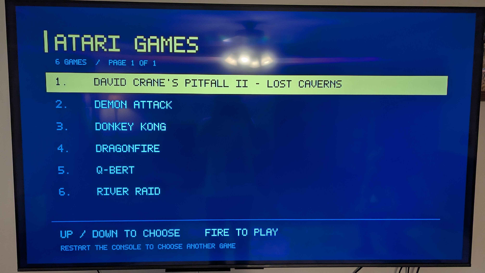

# Atari 2600+ Pac-Man internal game menu

A software sideloader for the **Atari 2600+ Pac-Man Edition running firmware
2.0.1.6**. Boot with an empty cartridge slot to choose a game stored inside
the console. Insert a cartridge before powering on to use normal cartridge
playback. No cutting, soldering, external game drive, or USB hub is required.



**Payload version: 0.3.6.** Empty-slot menu startup, joystick selection, Fire,
launch feedback, internal 2600 games, and cartridge playback were reported
working on one Pac-Man console. The internal 7800 path uses the firmware's
ProSystem core; individual games and controller combinations still need play
checks. This is a community project, unaffiliated with Atari.

## Compatibility

| Item | Support |
| --- | --- |
| Console | Atari 2600+ **Pac-Man Edition** only |
| Firmware | Exact 2.0.1.6 files identified by `profile.json` |
| Original 2600+ / 7800+ hardware | No supported firmware profile in this release |
| Atari 2600 games | `.a26`, `.bin`, or ZIP containing those files |
| Atari 7800 games | Headered `.a78`, or ZIP containing headered `.a78` |
| Host computer | Linux, Python 3.10+ |
| Game selection | Up/down, then Fire; six rows per page |
| Return to menu | Power the console off and on with the slot empty |

A 7800 game being supported does **not** imply support for installing this
payload on 7800+ hardware. Compatibility is also limited by the console's
existing emulator cores. Use a compatible two-button 7800 controller for games
that require both buttons.

## Start here

1. [Install from stock firmware](docs/INSTALL.md).
2. [Add, remove, or rename games yourself](docs/ADDING_GAMES.md).
3. [Restore an earlier setup or recover a failed write](docs/RECOVERY.md).
4. [Architecture and development notes](docs/TECHNICAL.md).
5. [Publish this source folder to GitHub](docs/PUBLISHING.md).

After the first successful setup, adding games is:

```sh
# Put the complete desired collection in your configured games folder.
# Connect the console in system update mode, then run:
python3 update_games.py
```

The updater remembers your local paths, makes a fresh backup, rebuilds the
catalog, writes only the OEM partition, and compares a complete readback with
the new image. Keep USB and power connected until it reports completion.
An interrupted flash write can require recovery using the saved backup.

## Source contents

| File | Purpose |
| --- | --- |
| `update_games.py` | Repeatable game updates with local settings and backup history |
| `device.py` | Temporary RAM loader, GPT/OEM backup, install and restore |
| `sideload.py` | Build and validate an OEM image from your own backup |
| `prepare_7800.py` | Add the correct A78 header to an exactly matched Ninja Golf NTSC ROM |
| `build_menu.py`, `payload/menu.c` | Build the native ARM game selector |
| `payload/*.sh` | Cartridge-first boot, game launch, and console-switch forwarding |
| `profile.json` | Pinned firmware hashes, layout, and patch locations |

No ROMs, firmware images, emulator binaries, or console backups are distributed
in this source folder. The build derives the required private binaries from
your own supported firmware backup. Local builds and backups contain firmware
and games and belong outside a public source release.

## Credits and license

This work grew out of a setup using
[MrBlinky's Atari2600plus-loader](https://github.com/MrBlinky/Atari2600plus-loader).
USB communication uses [Rockchip's rkdeveloptool](https://github.com/rockchip-linux/rkdeveloptool).
The menu dynamically uses SDL already present in the console firmware. Existing
Stella and ProSystem cores remain part of that firmware and retain their own
licenses. The source distributed here uses [CC0 1.0](LICENSE), matching the
upstream repository. Atari names and game titles identify compatibility.
